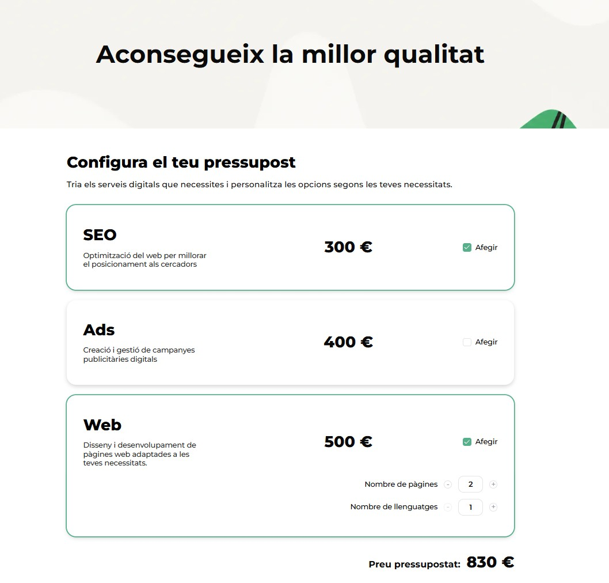
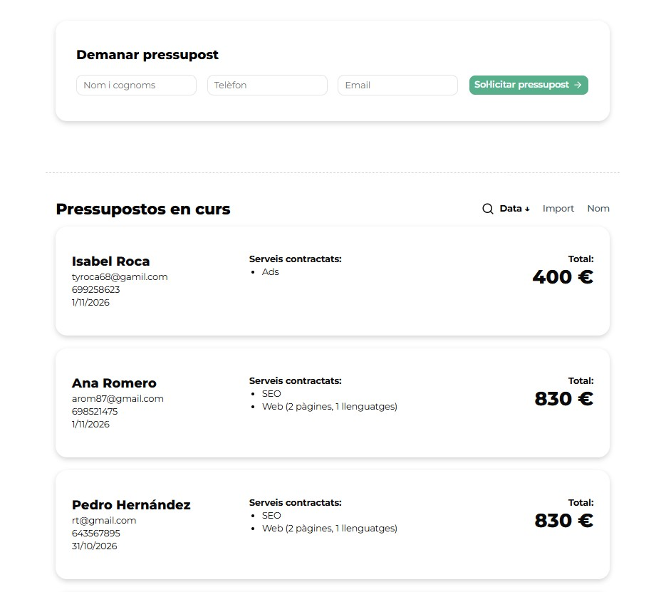
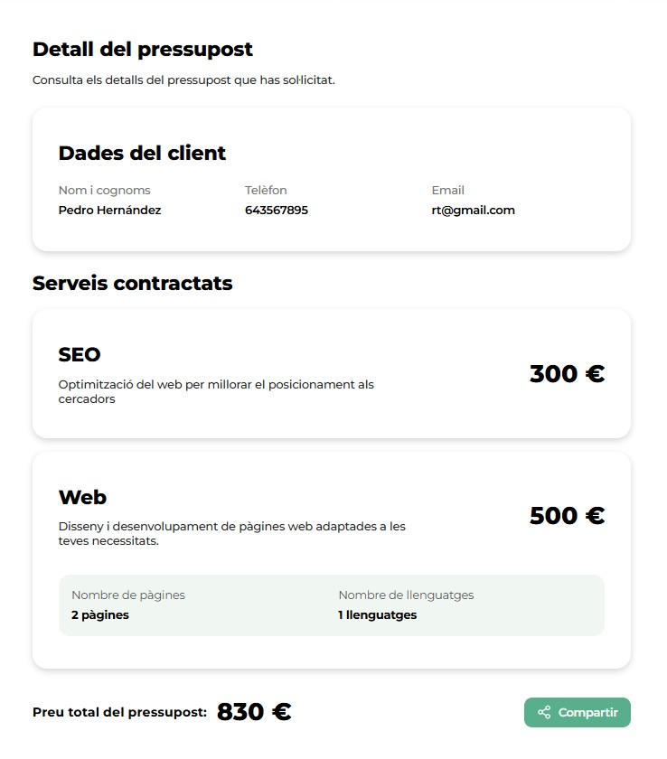
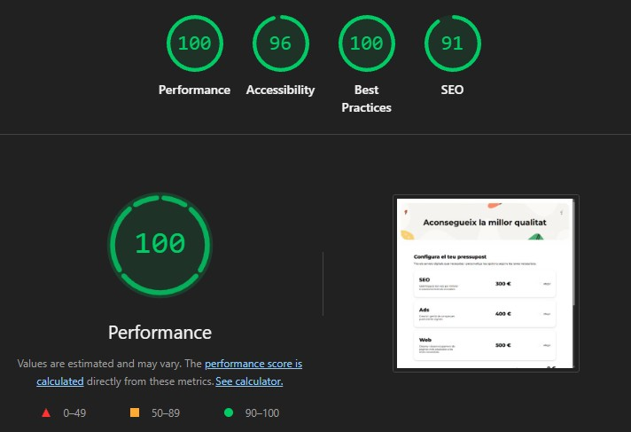
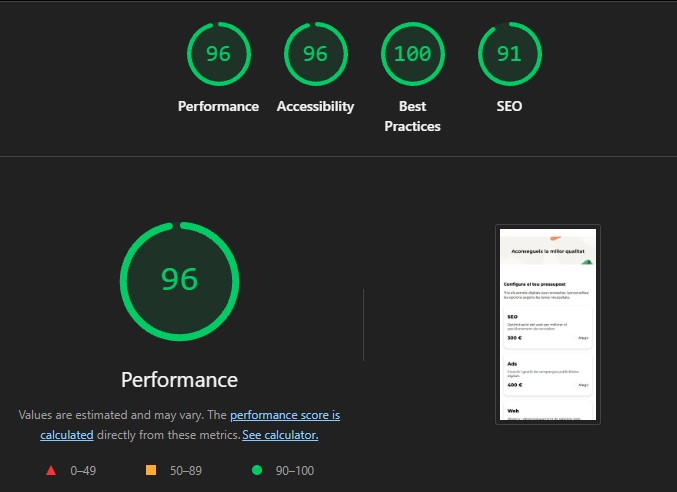

# 💰 Budget: Digital services budget generator

Web application (SPA) that instantly calculates personalized budgets for digital marketing and web development services. Users can select services, configure their options, enter their details and get a unique link to view or share their budget.

**Demo:** [Budget – Budget generator](https://ypmodev.github.io/budget-generator/)
## Application preview

<table>
  <tr>
    <td width="33%" align="center">
      <strong>Service selection</strong><br />
      
    </td>
    <td width="33%" align="center">
      <strong>Form and budgets</strong><br />
      
    </td>
    <td width="33%" align="center">
      <strong>Shared budget</strong><br />
      
    </td>
  </tr>
</table>

## Features

- **Level 1: Budget creation**
  - Service selection (SEO, Ads and Web) using checkboxes.
  - Web service configurator (number of pages and languages), with an informational notice about additional costs.
  - Dynamic calculation of the total amount.
  - Form with the client's details (full name, phone number and email), with validation.

- **Level 2: Budget history**
  - List of generated budgets, with access to the details of each one.
  - Search by name, email or phone number.
  - Sorting by date, amount or name.

- **Level 3: Sharing budgets**
  - Unique URL for each budget (`/budget/:id`), including the date, the client's details, the selected services, the breakdown and the total amount.
  - Button to copy the link.

  ## Technologies

- **React, TypeScript and Vite:** development of a single-page application (SPA) with static typing.
- **Tailwind CSS and shadcn/ui:** _mobile-first_ design, with `md` and `lg` breakpoints, and accessible components.
- **React Router:** management of the application routes and of each budget's detail page.
- **React Hook Form, Zod and @hookform/resolvers:** form management and data validation.
- **Sonner and lucide-react:** notifications and icons.
- **localStorage:** local storage and persistence of budgets.
- **Vitest and React Testing Library:** unit and component tests.

## Installation and usage

### Requirements

- Node.js 22
- npm

### Installation

Clone the repository and install the dependencies:

```bash
git clone https://github.com/ypmodev/budget-generator.git
cd budget-generator
npm install
```

### Run locally

```bash
npm run dev
```

Open the URL shown in the terminal in your browser.

### Other available commands

| Command                     | Description                                              |
| --------------------------- | -------------------------------------------------------- |
| `npm run build`             | Generates the production version in `dist/`.             |
| `npm run preview`           | Lets you preview the production version locally.         |
| `npx vitest run`            | Runs the automated tests.                                |
| `npx vitest run --coverage` | Runs the tests and generates the coverage report.        |

## How to use the application

1. Select the services you need. The total amount updates automatically.
2. If you select Web, set the number of pages and languages using the `+` and `−` buttons. The first time you press `+`, an informational notice about the cost of extras will appear (€30 for each additional page or language).
3. Enter your details and press **Sol·licitar pressupost**. At least one service must be selected.
4. The budget will appear in the **Pressupostos en curs** list, where you can search and sort budgets.
5. Select a budget to view its details and use the share button to copy its link.

## Project structure

```text
src/
├── components/
│   ├── layout/              Layout (general application structure)
│   ├── ui/                  Base shadcn/ui components
│   ├── Budget.tsx           Main budget creation component
│   ├── BudgetList.tsx       Budget list and history
│   ├── ServiceCard.tsx      Service selection card
│   ├── WebOptions.tsx       Web extras configuration
│   ├── ExtraCostModal.tsx   Informational modal about additional costs
│   ├── FormClient.tsx       Client details form
│   └── Banner.tsx           Application banner
├── data/                    services.json and texts.json (editable data and texts)
├── lib/                     utils.ts (shadcn/ui helper function)
├── pages/                   SharedBudget (budget detail)
├── router/                  router.tsx (route configuration)
├── schemas/                 clientFormSchema.ts (form validation)
├── services/                budgetStorage.ts (only access to localStorage)
├── test/                    ServiceCard.test.tsx and utils.test.ts
├── types/                   Shared types
└── utils/                   calculateBudget.ts and budgetFilters.ts (logic without React)

features/                    Gherkin scenarios
public/images/               Application banner
```

The components manage the interface, `utils/` contains the calculation and filtering functions, and `services/` handles budget storage.

## Tests

The project uses **Vitest** and **React Testing Library** to run unit and component tests.

The automated tests check the following behaviors:

- `ServiceCard`: selecting a service using the checkbox.
- `calculateExtraCostWeb`: calculation of the cost of additional pages and check that the cost is zero when there are no extras.
- `getSelectedServices`: retrieval of the selected services.

The behavior scenarios are documented separately in `features/services.feature`, following Gherkin syntax (`Given / When / Then`).

## Quality and accessibility

The metrics were obtained with **Lighthouse**, in an incognito window and on the production version generated with `npm run build`.

### Lighthouse screenshots

<table>
  <tr>
    <td width="50%" align="center">
      
    </td>
    <td width="50%" align="center">
      
    </td>
  </tr>
</table>

**Accessibility:** the application includes semantic HTML, labels associated with the form fields, ARIA attributes (`aria-invalid`, `aria-describedby`, `role="alert"`), keyboard navigation, visible focus and an accessible modal.

## Authorship

**Yanet Pérez** ([@ypmodev](https://github.com/ypmodev))